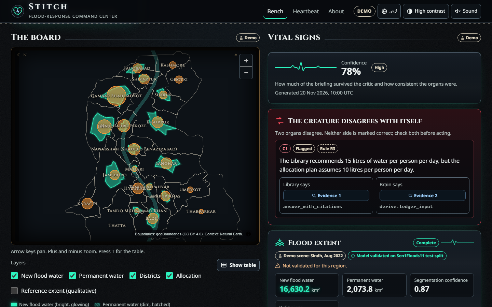
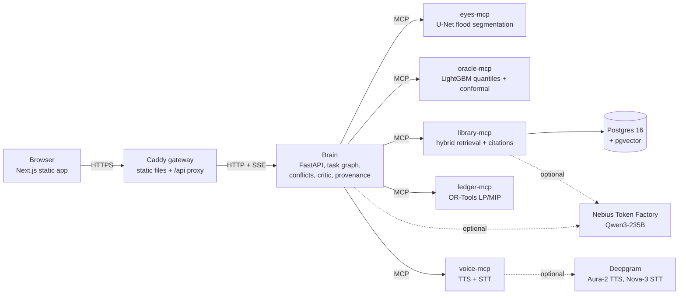

# Stitch

Stitch is a flood-response command center built for Kiroween 2026 (Frankenstein category). It stitches five AI "organs" into one creature: a flood-mapping model (Eyes), a river-discharge forecaster with calibrated intervals (Oracle), a cited guidance search (Library), an aid-allocation optimizer (Ledger) and speech in and out (Voice). A Brain orchestrates them, detects where they disagree, re-checks its own claims, and links every sentence of the briefing to the organ output it came from. The default scenario is the Sindh, Pakistan floods of August 2022, served entirely from committed demo data.

**Live demo:** https://stitch.aashirnoman.dev (press **Run briefing**; a full briefing takes about 30 s).

Stitch is a decision-support demo. It is not an operational warning system.



More screenshots in [`docs/screenshots/`](docs/screenshots/): the [full briefing](docs/screenshots/briefing-en-desktop.png), [evidence drill-down](docs/screenshots/evidence-en-desktop.png), [eval dashboard](docs/screenshots/evals-en-desktop.png), and [an organ failing gracefully](docs/screenshots/organ-error-en-desktop.png).

## Architecture



The browser talks only to the Brain's HTTP/SSE API. Organs never import each other; they share Pydantic models in `packages/stitch_common`, which mirror the MCP contracts in [`.kiro/steering/mcp-contracts.md`](.kiro/steering/mcp-contracts.md) (v0.6). Dashed links are off in the default offline demo.

## The five organs

| Organ | What it does | Headline metric |
|---|---|---|
| **Eyes** | U-Net (ResNet-18) on Sentinel-1 radar, int8 ONNX on CPU, order-independent tiling; flood extent, permanent water (JRC) and per-district areas | Sen1Floods11 hand-labeled test split: IoU 0.674, F1 0.805 (global VH threshold 0.533, Otsu 0.229) ([model card](organs/eyes/models/MODEL_CARD.md)) |
| **Oracle** | Modeled river discharge (GloFAS via Open-Meteo), LightGBM quantile models with split-conformal intervals and exceedance probabilities | CRPS 220 vs persistence 420 and climatology 488 (test 2017-2023); 0.8-interval coverage 0.790 ([method](docs/oracle-model.md)) |
| **Library** | Hybrid BM25 + dense retrieval with reranking; answers only with page-level citations, verified before return, and refuses when evidence is missing | Citation accuracy 0.976, citation validity 1.00, recall@8 0.90, refusal rate on unanswerable questions 0.91 ([README](organs/library/README.md)) |
| **Ledger** | Allocates water, food and shelter across districts with an equity floor, road access and budget; returns shadow prices and the equity trade-off curve | Feasibility rate 1.00 and MIP gap 0 on 24 synthetic instances ([method](docs/ledger-model.md)) |
| **Voice** | Speaks the briefing and transcribes questions (Deepgram in production, local Whisper and prerendered audio offline) | English round-trip WER 0.087 via Deepgram |

The **Brain** (custom asyncio task graph, no agent framework) scores faithfulness 1.00, provenance coverage 1.00, conflict recall 29/29 with 0/11 false positives ([design](docs/brain-design.md)).

## Run it locally

Requirements: Docker with Compose v2. No keys and no network access are needed for the demo.

```bash
git clone https://github.com/Aashir01/Flood-response-command-center.git
cd Flood-response-command-center
docker compose up -d --wait      # Postgres, Library, Ledger, Oracle, Brain, web gateway
# open http://localhost/
```

The plain `docker compose up` starts the core stack fully offline: `STITCH_MODE=demo`, the deterministic fake LLM replaying recorded Nebius replies, and no outbound network for any service. Eyes and Voice are optional profiles:

```bash
COMPOSE_PROFILES=full STITCH_ORGANS_DISABLED= docker compose up -d --wait   # all five organs
```

On hosts under 4 GB, add `-f deploy/compose.lite.yaml` (no reranker).

### Enabling Nebius and Deepgram

Copy `.env.example` to `.env` (names only, no values are committed) and set:

```bash
STITCH_LLM_PROVIDER=nebius
NEBIUS_API_KEY=...                 # Nebius Token Factory; model defaults to Qwen/Qwen3-235B-A22B-Instruct-2507
STITCH_TTS_PROVIDER=deepgram
STITCH_STT_PROVIDER=deepgram
DEEPGRAM_API_KEY=...
COMPOSE_PROFILES=full
STITCH_ORGANS_DISABLED=
```

Then start with the live override, which gives only the services that call external APIs an egress network:

```bash
docker compose -f compose.yaml -f deploy/compose.live.yaml up -d --wait
```

If a hosted service fails, the organ falls back (fake LLM replies, local Whisper, prerendered audio) and says so. Deployment to the VPS is described in [`deploy/README.md`](deploy/README.md).

### Development without Docker

```bash
uv sync                          # Python 3.12 workspace (one pyproject.toml per organ, root uv.lock)
uv run pytest -q                 # whole repo, sockets disabled for demo paths
cd frontend && npm ci && npm run dev:mock    # UI against the mock Brain
```

## Repository layout

```
.kiro/            steering, 9 specs (requirements, design, tasks), hooks, surgeon agent, MCP settings
organs/           eyes, oracle, library, ledger, voice: one MCP server each (core/ is pure logic)
brain/            planner, task graph, conflict rules, critic, provenance, FastAPI + SSE
packages/         stitch_common: contract models, provenance, LLM client, logging
frontend/         Next.js lab-bench UI (MapLibre, Framer Motion, Web Audio)
evals/            eval harness, datasets (Library question set, reference maps), results/
data/demo/        committed offline dataset with MANIFEST.md (source and license per file)
deploy/           Compose overrides, Dockerfiles, Caddyfiles, deploy and smoke scripts
docs/             model and design notes, decisions log, Kiro write-up, screenshots
scripts/          data builders, contract check, secret scan, organ scaffold
```

## Testing

- **Property-based tests:** 132 Hypothesis properties in Python plus fast-check properties in the frontend, each carrying its spec ID. Examples: Ledger allocation never exceeds supply and more supply never lowers coverage (LED-P1, P3); forecast intervals stay ordered p10 <= p50 <= p90 (ORA-P1); flood segmentation is identical for any tile order (EYE-P1); every Library answer has a valid citation or is an explicit refusal (LIB-P1); every briefing claim resolves to stored organ output (BRN-P1).
- **Unit, contract and integration tests:** `uv run pytest -q` runs about 1,450 tests across the repo; every tool's input and output is validated against the JSON Schemas generated from the contracts (`scripts/check_contracts.py`).
- **Frontend:** Vitest (150 tests) and Playwright scenarios with axe accessibility scans, reduced motion, keyboard-only use and RTL.
- **Evals:** `uv run python -m evals.run --fast --seed 0` writes `evals/results/*.json` and Parquet, which the UI's Heartbeat page reads. Evals are deterministic with fixed seeds and the fake LLM unless `--live-llm` is passed.
- **CI** (`.github/workflows/ci.yml`): lint, type checks (`mypy --strict` on `packages/` and `brain/`), tests, contract validation, eval smoke, Playwright, image builds, an offline stack smoke and a secret scan.

## Honest limitations

- **Eyes:** the model is validated on the Sen1Floods11 test split only. The Sindh scene is a demo scene and its extent is **not validated** for that region; the UI shows the two labels separately. The UNOSAT reference overlay is qualitative.
- **Oracle:** the target is **modeled** GloFAS river discharge (via Open-Meteo), not gauge observations. Every Oracle value is labelled "Modeled (GloFAS)".
- **Decision support only:** Stitch is a demo, not an operational warning system. Demo data is labelled as demo, and verifying actions with local responders and official warnings remains necessary.
- **Urdu:** the Urdu interface, RTL layout and Urdu briefing text are **experimental**: machine-translated and not reviewed by a native speaker. Urdu speech is not provided.
- **Live mode:** Oracle can read live Open-Meteo forecasts; Eyes has no live scene source and falls back to the demo scene with a visible notice.

## Built with Kiro

The project was built spec-first in Kiro: six steering files, nine specs with EARS requirements, five hooks, a custom `surgeon` agent that scaffolded every organ, and MCP servers for each organ. See [`docs/kiro-writeup.md`](docs/kiro-writeup.md).

## License and credits

MIT, see [LICENSE](LICENSE). Third-party code, datasets, models and services (Sen1Floods11, Copernicus Sentinel-1, JRC Global Surface Water, GloFAS via Open-Meteo, WorldPop, geoBoundaries, OpenStreetMap, OR-Tools, LightGBM, ONNX Runtime, Nebius, Deepgram and others) are listed with their licenses in [THIRD_PARTY.md](THIRD_PARTY.md).
