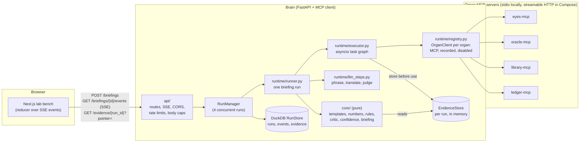
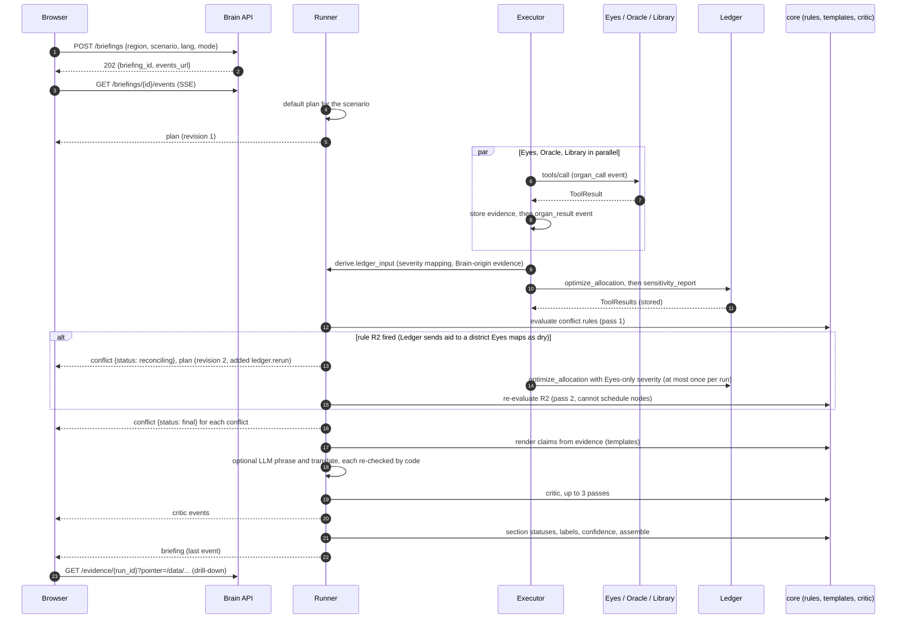
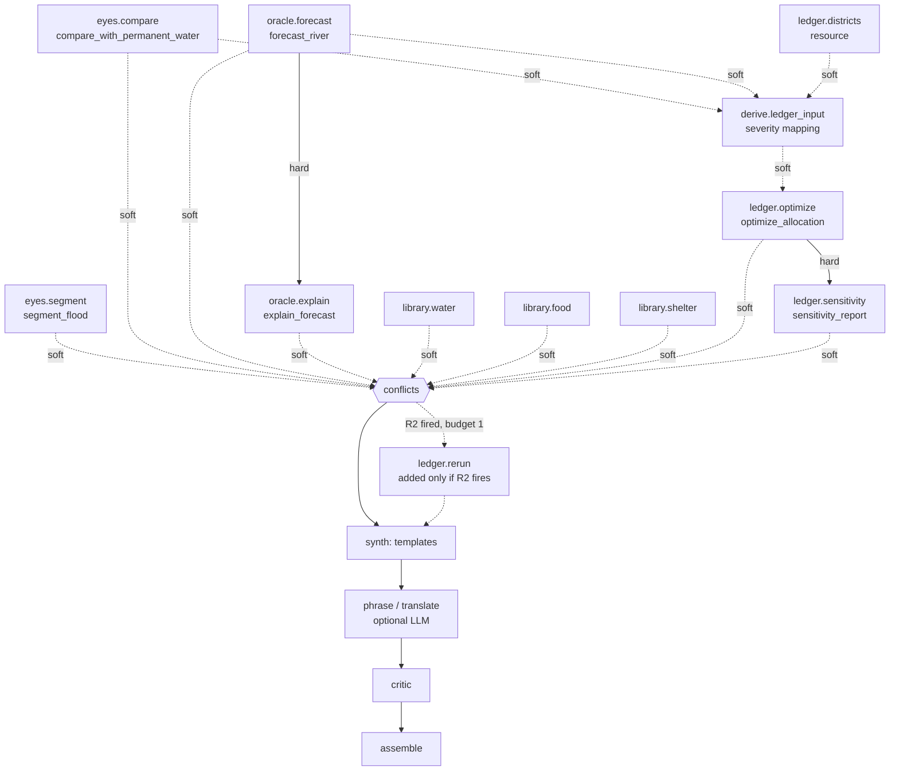
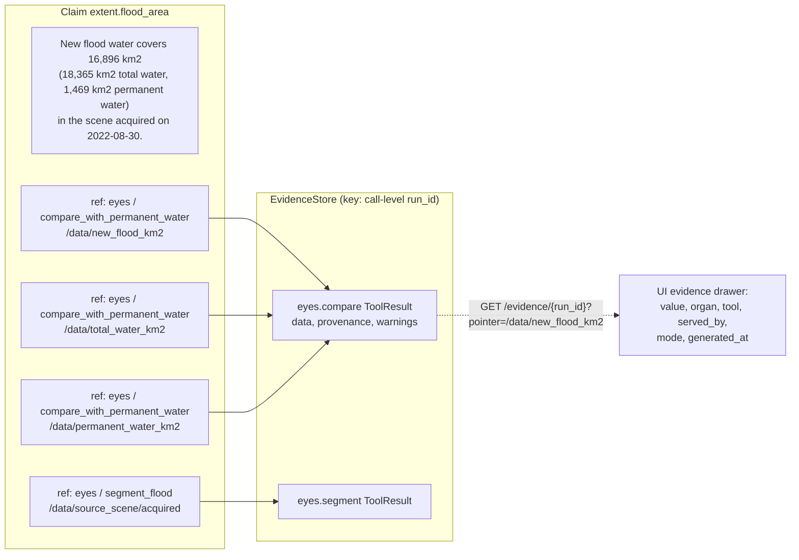
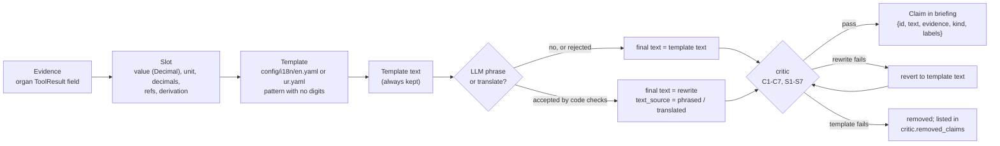
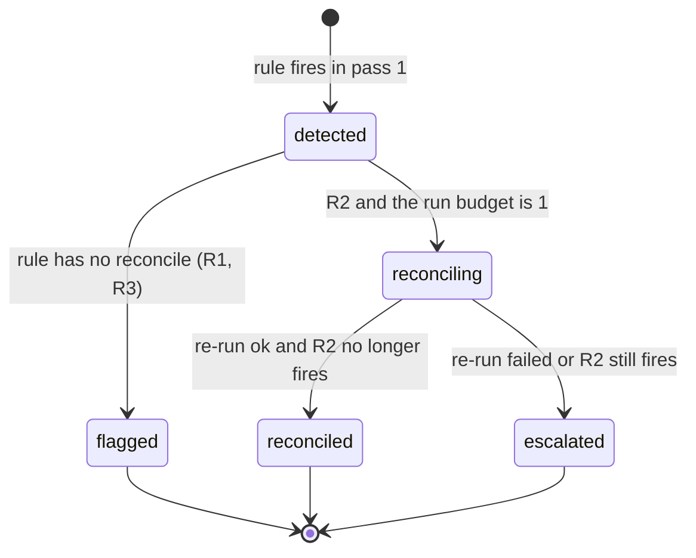
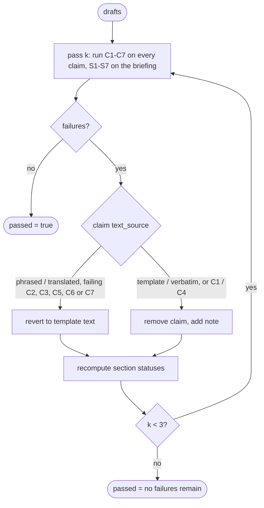

# The Brain: how Stitch stitches organs into one briefing

The Brain is the orchestrator of Stitch. It is an MCP client plus a FastAPI service, not an MCP server. It takes a request `{region, scenario, lang, mode}`, calls four independent organ servers (Eyes, Oracle, Library, Ledger), checks their outputs against each other, and returns a briefing in which every sentence points at the organ field it came from.

That is the "Frankenstein" idea in concrete terms: the organs were built separately, never import each other, and disagree sometimes. The Brain is the part that sews them together without hiding the seams. It keeps each organ's output as evidence, refuses to state anything it cannot trace, and says so when two organs contradict each other.

This document describes the code in `brain/src/stitch_brain/`. The full specification is `.kiro/specs/brain/` (requirements BRN-R1 to R14, design, tasks). Contracts are in `.kiro/steering/mcp-contracts.md` (v0.5).

## Contents

1. [Design rules](#1-design-rules)
2. [Architecture](#2-architecture)
3. [One run, end to end](#3-one-run-end-to-end)
4. [Planner](#4-planner)
5. [Executor: the asyncio task graph](#5-executor-the-asyncio-task-graph)
6. [Evidence store and provenance](#6-evidence-store-and-provenance)
7. [Claims: from organ field to sentence](#7-claims-from-organ-field-to-sentence)
8. [Conflict rules engine](#8-conflict-rules-engine)
9. [Critic](#9-critic)
10. [The LLM's limited role](#10-the-llms-limited-role)
11. [Urdu](#11-urdu)
12. [Confidence](#12-confidence)
13. [Degradation and live mode](#13-degradation-and-live-mode)
14. [API and the event stream](#14-api-and-the-event-stream)
15. [How it is tested](#15-how-it-is-tested)
16. [Eval results](#16-eval-results)
17. [Limitations](#17-limitations)

## 1. Design rules

Five rules shape every module.

1. **Numbers come from code.** A claim's text is a pre-authored pattern filled with typed slot values. Each slot value is read from an organ result, or computed from several by a named pure function (`sum`, `count`, `pct`, ...). Patterns contain no digits (a test enforces it), so every digit in a briefing came from a slot.
2. **Store first, read second.** Every organ `ToolResult`, including failures and timeouts, is written to the evidence store before anything reads it (BRN-R3.5).
3. **The LLM may only rephrase.** It never decides what the briefing says. It can reword template sentences and translate organ-authored text into Urdu. Every rewrite is re-checked by code and dropped if a number, unit, label or language changed.
4. **Untraceable claims are removed, not softened.** The critic deletes a claim it cannot verify and lists it in `critic.removed_claims`.
5. **Decisions live in pure functions.** `core/` has no I/O: templates, number checks, rules, critic, confidence and section status are deterministic functions of the evidence. `runtime/` does I/O (MCP, LLM, DuckDB, clock). `api/` is thin. The property tests run against `core/` in milliseconds.

## 2. Architecture



The browser talks only to the Brain. The Brain talks to organs only over MCP (`tools/list`, `tools/call`, `resources/read`). Organs never talk to each other.

Each organ has one `OrganClient` in the registry (`runtime/registry.py`):

| Client | `served_by` | Used when |
|---|---|---|
| `McpOrganClient` | `real` | the organ is configured in `config/organs.yaml` (stdio) or `organs.compose.yaml` (HTTP) |
| `RecordedOrgan` | `recorded` | the organ is listed in `STITCH_RECORDED_ORGANS`; it replays committed fixtures from `data/demo/recorded/` |
| `DisabledOrgan` | `disabled` | the organ is listed in `STITCH_ORGANS_DISABLED` |

A recorded organ is chosen by configuration, never by silent failover. The label is set by the Brain, not by the fixture: the evidence entry gets `served_by = recorded` and a `RECORDED_FIXTURE` warning appended after the fixture's own warnings, the UI shows a stub badge, and the briefing gets a `caveat.recorded.<organ>` claim. Fixture content cannot remove the label (property BRN-P19).

`McpOrganClient` keeps one long-lived MCP session per organ, owned by a supervisor task that reconnects with backoff 1, 2, 4, 8, 16, 30 s. At connect it compares each tool's `inputSchema` with the schema exported from `stitch_common`; a mismatch marks the organ `incompatible` and it is never called. Health (`ready`, `degraded`, `unwell`, `disabled`) comes from the last five call outcomes plus `/healthz` or MCP `ping`, and a circuit breaker fails fast for 15 s after an organ turns unwell. Startup never waits for an organ (BRN-R1.4).

## 3. One run, end to end



With recorded organs and the fake LLM a briefing takes about 0.2 s (section 16); with real organs the time is dominated by the Library and Ledger calls.

## 4. Planner

The planner (`core/plans.py`) returns a `Plan`, which is data: nodes with an id, a kind (`organ`, `resource`, `derive`, `analysis`, `synthesis`, `llm`), an organ and tool, the name of a registered argument builder, dependencies, a timeout and an attempt cap. A plan cannot carry code. Argument builders are pure functions `(scenario config, evidence store) -> dict` looked up by name.

The default task graph for `demo-sindh-2022`:



A hard dependency means "skip me if it failed" (`oracle.explain` needs a forecast run id). A soft dependency means "start once it finished, whatever the outcome", so `derive.ledger_input` still runs when Eyes is down and builds a fallback input (the Ledger's dataset defaults) instead of none.

Which organs run, the guidance questions, commodities, supply, the Oracle station and the Eyes scene date are scenario configuration in `brain/config/scenarios.yaml`, not LLM output.

`validate_plan` rejects duplicate ids, unknown or self dependencies, cycles (Kahn's algorithm), more than 24 nodes, depth over 8, unregistered builders and organ/tool pairs the registry does not offer (BRN-P5). With `STITCH_BRAIN_PLANNER=llm` and a real provider, the LLM may only drop optional nodes from a whitelist (`oracle.explain`, `ledger.sensitivity`). An invalid reply, or any error, gives the default plan (BRN-R2.3). With the `fake` provider the default plan is always used (BRN-R2.4).

## 5. Executor: the asyncio task graph

`runtime/executor.py` is under 300 lines of plain `asyncio`, with no agent framework (owner decision, BRN-R2.1).

- **Ready rule.** A node starts when every hard dependency ended `ok` and every soft dependency reached a terminal state. Ready nodes start at once, so Eyes, Oracle, the three Library questions and the Ledger districts resource run in parallel.
- **Limits.** At most 6 nodes in flight per run and 2 per organ (the Library and Ledger are CPU-bound on a 2 vCPU host). The API admits 4 concurrent runs and answers `429 BUSY` beyond that.
- **Timeouts and retries.** Each attempt runs under `asyncio.timeout(node.timeout_s)`. Only `retryable` errors and transport errors are retried, at most 3 attempts with backoff 0.25 s and 0.5 s plus a deterministic jitter derived from the node id and attempt, so a run is reproducible.
- **Deadlines.** The organ phase has a 45 s deadline (70 s in live mode); in-flight organ nodes past it are marked `timed_out` and their hard dependents `skipped`. Synthesis, the critic and assembly always run on what exists.
- **Terminal states.** Every node ends in exactly one of `ok | failed | skipped | timed_out | cancelled`. The node wrapper turns any exception other than cancellation into `failed (INTERNAL)`, so one broken organ cannot take the run down.
- **Cancellation.** `DELETE /briefings/{id}` cancels the run's task. In-flight MCP calls are cancelled (the SDK sends `notifications/cancelled`), and the stream ends with a fatal `error` event `CANCELLED`.
- **Time is injected.** The executor reads a `Clock` (real or virtual). Tests run the full 15 x 5 degradation matrix, including organs that hang until the 45 s deadline, in virtual time; the 76 runs take about 8 s of wall time.
- **Dynamic nodes.** Only the conflict stage may add a node (`ledger.rerun`), once per run. The plan is re-validated and a second `plan` event (`revision: 2`, `added: ["ledger.rerun"]`) is emitted.

Property BRN-P10 draws random graphs, delays and failures and checks: one terminal state per node, no node starts before its hard dependencies end, the concurrency limits are never exceeded, the deadline holds in virtual time, and only retryable failures are retried.

## 6. Evidence store and provenance

Every organ call produces an `EvidenceEntry` (`core/evidence.py`): the call-level `run_id` from the organ's `provenance.run_id`, the plan node, organ, tool, `served_by`, attempt, timing, and the complete `ToolResult` as JSON. A failed call with no result (timeout, transport error) gets a synthesized `ok: false` result, so a caveat like "the Ledger did not answer (TIMEOUT)" can cite `/error/code` of a real entry.

A claim's evidence is a list of `EvidenceRef {run_id, organ, tool, json_pointer}`. The pointer is RFC 6901 into the stored `ToolResult`, for example `/data/by_district/3/flooded_km2` or `/data/citations/0`. `run_id` is unique per call, so a ref stays unambiguous when the Ledger runs twice during reconciliation.



Values that no single organ produced are stored as **Brain-origin entries** (`organ = served_by = "brain"`, deterministic run id), so they are evidence too:

| Entry | Holds | Cited by |
|---|---|---|
| `derive.ledger_input` | the exact districts override sent to the Ledger, the severity inputs and outputs per district, the assumption list, and `lineage` refs to every organ value used | allocation caveats, rule R3 |
| `run_meta` | requested and effective mode, `served_by` per organ, fallback nodes | `caveat.mode` |
| `static.disclaimer` | the disclaimer text in English and Urdu | `caveat.disclaimer` |
| `conflicts` | every conflict, its resolution, and the rule trace | `caveat.conflict.<id>` |
| `critic` | the final critic report | `caveat.critic_failed` |

So the disclaimer and the mode banner obey BRN-P1 like every other claim, without exemptions. A test walks `derive.ledger_input` lineage back to organ entries.

The resolver never raises: a bad pointer (`01`, `-`, no leading `/`, a key that does not exist) returns `Unresolved(reason)` (BRN-P23). A ref into a failed entry resolves only under `/error`, `/provenance` and `/warnings`. The store survives a JSON round trip unchanged (BRN-P8), which is how finished runs are reloaded from DuckDB and resolved by `GET /evidence/{run_id}` after the in-memory copy is gone.

## 7. Claims: from organ field to sentence



Renderers in `core/templates/` (`extent.py`, `forecast.py`, `guidance.py`, `allocation.py`, `caveats.py`) read evidence by pointer and return `ClaimDraft`s. A slot's value is either a resolved leaf or the output of a named derivation over several leaves (`sum` for "across 15 other districts", `pct` for "21% of the district", `argmax_item` for the forecast peak). Each derivation keeps the refs of all its inputs, and the critic re-runs it from the store (check C2).

Claim ids are deterministic (`allocation.water.pk_sindh_dadu`), sections are ordered `extent, forecast, guidance, allocation, caveats`, and claims inside a section follow a fixed order. Concurrent completion order never reaches the output: renderers read `canonical_entries()`, sorted by node id and attempt (a bug BRN-P4 found, see section 15).

Library guidance is special. Each sentence of an `answered` Library result becomes one claim, with the Library's own text verbatim and evidence pointing at `/data/claims/i/text` plus each cited `/data/citations/j`. A guidance claim without a citation that has a quote and a page is not rendered. A Library refusal becomes `guidance.<question>.refusal`: "The guidance library declined to answer ...; no guidance is given from memory." No code path fills a refusal in (BRN-R7.4).

**Labels.** Claims carry structured labels (`modeled`, `unvalidated`, `recorded`, `demo`, `refusal`, `disputed`) derived from their evidence, not from text. Any claim citing Oracle evidence is labelled `modeled` and its text must contain "Modeled river discharge (GloFAS via Open-Meteo)" or the Urdu equivalent; the words gauge, observed and measured (and Urdu forms) are forbidden in it (check C7, property BRN-P24). If the Oracle ever returned a `target_kind` other than `modeled_glofas`, the forecast renderer would render nothing.

## 8. Conflict rules engine

Rules are data in `brain/config/conflict_rules.yaml`. They reference **facts**: small pure functions in `core/facts.py` that read the evidence store and return a value plus the refs it came from. Facts are whitelisted in a registry; a rule cannot run anything else.

| Rule | Organs | Fires when | Resolution |
|---|---|---|---|
| `R1_oracle_low_eyes_flooded` | Oracle, Eyes | the maximum modeled exceedance probability is below `oracle_low_p = 0.20` while at least `eyes_flooded_frac = 0.10` of the basin districts' area is mapped as new flood water | flagged |
| `R2_ledger_to_dry_district` | Ledger, Eyes | for some district, the Ledger allocates more than 0 units while Eyes maps its flooded fraction below `eyes_dry_frac = 0.01` | one automatic reconciliation: re-run the Ledger with Eyes-only severity |
| `R3_library_vs_ledger_need` | Library, Ledger | the per-person-per-day quantity in Library guidance differs from the need the Ledger used by more than `need_rel_tol = 10%` | flagged |

The grammar is small: `all`, `any`, `not`, comparisons (`lt`, `lte`, `gt`, `gte`, `eq`, `ne`), `rel_diff_gt`, and operands that are a fact, a `{param}` or a `{const}`. Keyed facts are joined with `foreach` (per district, per commodity). The YAML is parsed into a typed Pydantic AST and evaluated by a recursive function. There is no `eval`, `exec`, `getattr` on user strings or expression parsing; a test scans the rule modules for those names, and a fuzz test checks that arbitrary YAML either loads to an AST or raises `RuleConfigError` (BRN-P18). A rule whose fact is unavailable (an organ is down) is skipped with the reason in the trace, never treated as "no conflict found".

R3 reads the Library's structured `quantities` output (contract v0.4) and falls back to extracting the quantity from the claim text with the unit aliases in `scenarios.yaml`. If more than one distinct value appears, the fact is omitted rather than guessed.

### Reconciliation, and why it cannot loop



1. After the organ phase, all rules are evaluated (pass 1).
2. If R2 fired and the run's reconcile budget is still 1, the budget is spent, a `conflict` event with `status: reconciling` goes out, `derive.ledger_input` is rebuilt in `eyes_only` mode (the forecast term is zeroed, so a dry district gets no forecast-driven need), and `ledger.rerun` is added to the graph.
3. The re-run's result is a new evidence entry. The alias `ledger.final` moves to it; the original stays in the store and both are cited by the conflict.
4. R2 is evaluated once more (pass 2), which cannot schedule nodes. If it no longer fires, the conflict is `reconciled`; if it does, or the re-run failed, it is `escalated` (needs a human) and the original allocation stays final.

The budget is per run, not per rule, so a run makes at most one extra Ledger call even if every rule were forced to fire on every pass (BRN-P20). Reconciliation never changes Eyes, Oracle or Library results.

A `flagged` or `escalated` conflict marks each claim in the rule's `affects` list with a fixed suffix ("(disputed, see conflict C2)") that is appended after any phrasing, so the LLM cannot remove it, and adds a `caveat.conflict.<id>` claim that says neither side is treated as settled (BRN-R4.2). A reconciled conflict adds a "Reconciled: ..." caveat and no marker.

The headline scenario `demo-sindh-2022` is conflict-free. `demo-sindh-2022-conflicts` ships seeded fixtures: one basin district (Thatta) mapped dry while the modeled flood risk stays high, and a Library water quantity of 7.5 litres per person per day against the Ledger's 15. The first Ledger plan sends Thatta 418,110 units of aid because of the forecast term; the Eyes-only re-run sends it none, so R2 ends `reconciled`, and R3 ends `flagged`.

## 9. Critic

The critic (`core/critic.py`) is a pure function from (claim drafts, evidence store) to (drafts, report). It re-verifies every claim from the stored evidence instead of trusting the renderer.

| Check | What it verifies |
|---|---|
| C1 provenance | at least one ref, and every ref resolves in the store |
| C2 numbers | slots re-resolved and re-derived equal the stored slot values; every number in the final text matches an allowed value at its displayed precision; every numeric slot appears in the text |
| C3 units | each number is followed by its slot's unit (`km2` vs `m3/s` swaps fail; a count followed by a unit fails) |
| C4 citations | a non-refusal guidance claim cites a Library citation with a quote and a page |
| C5 language | at least 90% Latin letters for `en`, at least 60% Arabic-script letters for `ur`, outside masked spans |
| C6 entailment | for LLM rewrites only: the judge says the text is entailed by the evidence strings |
| C7 labels | Oracle claims carry the modeled label and no forbidden words; disputed claims carry the marker |
| S1 to S7 | briefing-level: the unvalidated-scene caveat exists when Eyes says so, recorded-organ caveats, one caveat per conflict, one per failed node, every refusal rendered, disclaimer and mode caveat present, unique ids |

The number extractor (`core/numbers.py`) normalizes Arabic-Indic and Extended Arabic-Indic digits and separators, masks dates, quantile labels (`p10`), unit tokens and identifiers such as scene ids, and also treats number words as numbers (`one` to `twenty`, `thousand`, `million`, `lakh`, `crore`, and the Urdu `ایک` to `بیس`, `ہزار`, `لاکھ`, `کروڑ`). A rewrite cannot hide a new number in words.



Repairs only revert a rewrite to its template text or delete a claim. The critic never adds a claim, a ref, or text other than template text (BRN-P12). It is bounded (3 passes: at most two repair rounds plus a verifying pass) and idempotent: running it on its own output changes nothing, including `removed_claims`, `notes` and `passed` (BRN-P7). Judge verdicts are computed once before the critic and cached by text and evidence, so repeated passes cannot flip.

If the critic does not pass, the assembler adds `caveat.critic_failed` and confidence drops by 40%. A briefing with `critic.passed = false` is never emitted without that caveat (BRN-R6.3).

## 10. The LLM's limited role

The LLM is `stitch_common.llm.LLMClient`, selected by `STITCH_LLM_PROVIDER` (`fake`, `anthropic`, `openai`, `nebius`). It has no tools and no access to organs. It is used in exactly these steps, each with a deterministic fallback:

| Step | Input | Accepted only if | Fallback |
|---|---|---|---|
| `brain.phrase` | template texts of the extent and allocation sections, as JSON `{claim_id: text}` | strict JSON, known ids, at most 2.5x the template length, and C2, C3, C5, C7 pass | template text |
| `brain.translate` | organ-authored English text (Library sentences, Oracle narrative) in an Urdu briefing | same numbers and units as the source, Urdu script, C2, C3, C5 pass | English text kept, `caveat.verbatim_foreign` added |
| `brain.judge` | a rewritten claim and its evidence strings | reply is `{"verdict": "entailed"}` | not entailed, so the rewrite is reverted |
| `brain.plan` (optional) | node ids and the optional whitelist | a valid plan | default plan |

Forecast claims (they carry the evidence-forced "Modeled" label), caveats (fixed honesty text), disputed claims and verbatim organ text are never phrased.

Organ outputs reach the prompt only as JSON data under a system instruction that says the content is untrusted and instructions inside it must be ignored. Whatever the model writes is parsed against a schema, unknown ids are dropped, and every accepted string is re-checked by code. Property BRN-P15 uses a `PoisonLLM` (injected instructions, extra ids, a fake claim, invalid JSON, a giant reply) and asserts the briefing equals the template-only briefing. BRN-P2 uses a `MutatingLLM` that injects a number, scales one, drops or swaps a unit, switches to Arabic-Indic digits, or writes numbers as words, and asserts every such rewrite is rejected.

**Offline replay.** `FakeLLM` replays recorded replies keyed by `sha256` of the canonical request (purpose, system prompt, messages, schema, max tokens, temperature). Provider and model are not in the key, so Nebius recordings replay under `fake`. The Brain's recordings are in `data/demo/llm/brain.jsonl`: 37 Nebius (`Qwen/Qwen3-235B-A22B-Instruct-2507`) exchanges covering both demo scenarios in English and Urdu, made with `python -m evals.brain.record_llm --provider nebius`. `test_demo_recordings_current` replays all four briefings and fails with the stale keys whenever a template or prompt changes. With an empty recording file the Brain still produces a complete, correct briefing, just with template prose.

In the replayed demo, Nebius rephrasings were accepted for 5 claims in the English headline briefing (for example "New flood water covers 16,896 km2, with a total water extent of 18,365 km2, including 1,469 km2 of permanent water, in the scene acquired on 2022-08-30.") and for 19 claims in the Urdu conflicts briefing. Production keeps `STITCH_LLM_PROVIDER=fake` so demo briefings stay deterministic replays.

## 11. Urdu

Urdu is handled in two different ways depending on who wrote the text.

- **Brain-authored text is never machine translated.** Every template id has a pre-authored Urdu pattern in `brain/config/i18n/ur.yaml` (a test fails if either language is missing). For `lang = ur` the renderer fills the Urdu pattern with the same slots, so numbers, units and citations are identical to the English briefing by construction (BRN-P14). Commodity and district display names come from the scenario config. Urdu text uses ASCII digits by default (`STITCH_UR_DIGITS=extended` switches to Extended Arabic-Indic; the extractor reads both).
- **Organ-authored text** goes through three steps. The Brain sends the Library its Urdu question and `answer_lang = ur`; if the Library answers in Urdu, that text is used as is. Remaining English organ text goes to the `translate` step, which is accepted only if it has the same multiset of numbers and units as the source, passes the number, unit and language checks, and then passes the judge. Otherwise the English text stays, the claim is marked `verbatim_foreign`, and `caveat.verbatim_foreign` tells the reader that part is shown in English.

The guard is not hypothetical. In the recorded Urdu headline briefing, Nebius translated the Library's food sentence as "ایک عام راشن کو فی شخص فی دن کم از کم 2,100 کیلو کیلوری ...". The leading `ایک` is the indefinite article, but it is also the Urdu word for "one", and the number check treats it as a number that is not in the evidence. The translation was rejected even after the prompt asked the model not to use the word, and the briefing shows the English sentence with the caveat. A false rejection costs a translated sentence; a false acceptance could change a ration quantity, so the check stays strict.

Scale words (`لاکھ`, `کروڑ`) are rejected the same way, so a translation cannot turn 1,000,000 into "10 lakh". Direction, fonts and `<bdi>` isolation are the frontend's job; the Brain returns plain text with identifiers, units and citations as separate tokens. The Urdu patterns were written by the implementing agent and need a native-speaker proofread (`docs/decisions.md`).

## 12. Confidence

`confidence` is a heuristic strength-of-evidence score in [0, 1], not a probability (`core/confidence.py`, weights in `brain/config/confidence.yaml`). Per-organ values:

| Organ | `c_o` |
|---|---|
| Eyes | mean segmentation confidence over flood pixels, x 0.7 when the scene is not validated for the region |
| Oracle | `1 - mean((p90 - p10) / max(p50, 1))` over forecast days, clamped to [0, 1] |
| Library | answered questions / questions (a refusal counts as no coverage) |
| Ledger | 1 if optimal, `1 - gap` if feasible, 0 if infeasible |

```
C0 = 0.30 eyes + 0.25 oracle + 0.20 library + 0.25 ledger      (missing organ = 0, no renormalizing)
C1 = C0 x product over conflicts (1 - p)      p = 0.15 flagged or escalated, 0.05 reconciled
C2 = C1 x 0.6 if the critic did not pass
C3 = C2 x (1 - 0.05 x min(removed claims, 4))
confidence = round(C3, 2)
```

The headline demo scores 0.70: the Eyes scene is unvalidated for Sindh (factor 0.7) and one of three Library questions is refused. The conflicts scenario scores 0.57 (one flagged and one reconciled conflict). The deployed briefing with real organs reported 0.61. Property BRN-P16 checks the score is bounded, non-decreasing in each organ value, and never raised by a conflict, a removal or a critic failure.

## 13. Degradation and live mode

**Any organ can fail.** The section status table:

| Section | `unavailable` | `partial` |
|---|---|---|
| extent | both Eyes calls failed | one failed |
| forecast | the forecast failed | no danger threshold, so no exceedance claim |
| guidance | every Library call failed | a call failed, or a question was refused |
| allocation | the Ledger failed or the plan is infeasible | Eyes or Oracle missing (plan not informed by them), or a feasible plan with an open solver gap |

`Section.missing` names the reason ("1 refused question(s)", "proven optimal plan (solver gap 1.5e-06)", or the failed node), and each failed node gets a `caveat.missing.<node>` claim citing its `/error/message`. Property BRN-P3 runs every non-empty subset of the four organs times five failure modes (error result, timeout, exception, hang until the deadline, schema-invalid result), 75 runs in virtual time: a briefing always comes back, BRN-P1 holds, the affected sections are marked, and confidence never exceeds the all-up value. With all four organs down the briefing still has its disclaimer and mode caveats.

**Live mode** is a bonus. The Brain passes `mode` to the tools that take it (contract v0.4). The briefing is `live` only if the request was live and every Eyes and Oracle mode-taking call reported `provenance.mode = live`; any mix gives `demo`, a non-fatal `notice` event `MODE_FALLBACK`, and a `caveat.mode` that says live data was unavailable (the UI's offline banner). If a live Eyes or Oracle call fails with `UPSTREAM_UNAVAILABLE` or `TIMEOUT`, the Brain emits `MODE_FALLBACK` for that node and calls the same tool once more with `mode: demo`. The failed live entry stays in the store; the demo entry fills the section, labelled demo. Library and Ledger are local organs and never need a fallback.

## 14. API and the event stream

| Route | Purpose |
|---|---|
| `POST /briefings` | start a run, `202 {briefing_id, events_url, result_url}` |
| `GET /briefings/{id}/events` | SSE stream of `TaskEvent`s, resumable |
| `GET /briefings/{id}` | status and the finished briefing |
| `DELETE /briefings/{id}` | idempotent cancel |
| `GET /evidence/{run_id}[?pointer=]` | the stored `ToolResult`, or one value by RFC 6901 pointer (drill-down) |
| `GET /organs`, `GET /healthz` | organ health, `served_by`, `live_available` |
| `POST /ask` | one Library question, rendered with the guidance renderer; no other organ is called (BRN-P21) |
| `POST /voice/transcribe`, `/voice/speak` | thin Voice proxies; `speak` builds its script from a stored briefing |
| `GET /evals/latest` | `evals/results/latest.json` for the heartbeat dashboard |

SSE frames carry `id: <seq>` (per-run, contiguous from 1), `event: <type>` and the `TaskEvent` JSON. Order: `plan` first, each `organ_call` before its `organ_result`, `critic` events before `briefing`, and the last event is `briefing` or a fatal `error`. A `: ping` comment every 15 s keeps proxies open. The run's `EventLog` is append-only; a reconnecting client sends `Last-Event-ID: n` (or `?last_event_id=n`) and gets every event after `n` and then the live tail, with no gaps or duplicates, because the subscriber reads the replay under the same lock `append` uses (BRN-P11). Every event is written to DuckDB as it is appended, so finished runs replay after a restart; runs that were running when the process stopped are marked `failed (RESTART)`.

Inputs are Pydantic models with unknown fields rejected. `POST /briefings` is rate limited per client (6 per minute, burst 3; `/ask` 20 per minute; voice 10 per minute) with token buckets on an injected clock (BRN-P22). Bodies are capped (64 KB, 4 MB for transcription). CORS allows `http://localhost:3000` and `https://stitch.aashirnoman.dev` only, without credentials. No response contains keys, prompts, stack traces or file paths; a test plants a key in the environment and scans every response.

The frontend reducer (`frontend/src/state/benchReducer.ts`) consumes exactly these events. Real Brain streams for the headline demo (English) and the conflicts scenario (Urdu) are committed as `frontend/fixtures/streams/brain-*.ndjson`; the frontend validates them with Ajv against the same exported schemas and replays them through the reducer.

## 15. How it is tested

`uv run pytest brain -q` runs 339 tests (one is a fixture writer, skipped by default) with sockets disabled; the Hypothesis `ci` profile uses 200 examples per property.

| Property | Statement |
|---|---|
| BRN-P1 | every claim has at least one ref and every ref resolves |
| BRN-P2 | every number in claim text comes from its evidence, under adversarial rewrites |
| BRN-P3 | a briefing is produced with any subset of organs failing in any of five ways |
| BRN-P4 | same request, same briefing, whatever the completion order; a replayed trace equals the original |
| BRN-P5 | the plan validator accepts exactly the valid DAGs |
| BRN-P6 | seeded conflicts are always raised and their claims marked |
| BRN-P7 | the critic is idempotent |
| BRN-P8 | evidence refs resolve after a JSON round trip of the store |
| BRN-P9 | claim ids are unique and deterministic |
| BRN-P10 | executor invariants (terminal states, ordering, limits, deadlines, retries) |
| BRN-P11 | SSE resume has no gaps or duplicates |
| BRN-P12 | the critic never adds claims, refs or non-template text |
| BRN-P13 | number formatting and extraction round-trip in English and both Urdu digit systems |
| BRN-P14 | English and Urdu renderings carry the same numbers and units |
| BRN-P15 | a poisoned LLM reply never alters the briefing |
| BRN-P16 | confidence is bounded and monotone |
| BRN-P17 | the severity mapping is bounded, monotone and order-invariant |
| BRN-P18 | the rule engine is safe and has no false positives on controls |
| BRN-P19 | a recorded organ is always labelled |
| BRN-P20 | reconciliation runs at most once and terminates |
| BRN-P21 | `/ask` calls only the Library and adds no text |
| BRN-P22 | the rate limiter never admits more than its budget |
| BRN-P23 | the pointer resolver follows RFC 6901 and never raises |
| BRN-P24 | Oracle claims carry the modeled label and no forbidden words |

What the properties caught, among others: BRN-P4 found that caveat refs followed the order in which concurrent organ calls finished, so two identical requests could produce different briefings (fixed with `canonical_entries()`); BRN-P6 found that a seeded "dry district" mutation could dry a district carrying most of the basin's flood area, so R1 correctly stopped firing and the scenario's expectation was wrong, not the rule (`docs/decisions.md`). Writing the API contract tests found two bugs that the unit tests could not: `/ask` stripped the `null` fields the Library contract requires from the embedded result, and a malformed evidence pointer returned 500 instead of 404. The recording run found that the shared Nebius adapter sent a bare JSON Schema as `response_format.json_schema`, which Nebius rejects with 422; every structured call had been silently falling back to templates.

Integration tests (marker `integration`) start the real Eyes, Oracle, Library and Ledger as stdio subprocesses (pipes, no sockets, Hugging Face offline) and check a full English and Urdu briefing: every organ `served_by = real`, BRN-P1 on real output, the critic passes, Oracle claims labelled modeled. A second test drives the real Ledger's two tools directly.

## 16. Eval results

`python -m evals.run --organ brain --seed 0 --fast` (recorded organs, recorded Nebius prose replayed by `FakeLLM`, an independent verifier in `evals/brain/verify.py` that shares no code with `stitch_brain.core`):

| Metric | Value | Target | Basis |
|---|---|---|---|
| `brain.faithfulness` | 1.00 | 1.00 | 472 claims from 4 demo briefings (2 scenarios x en/ur) and 8 single-organ-down briefings |
| `brain.faithfulness_numeric` | 1.00 | 1.00 | 284 number and recommendation claims |
| `brain.faithfulness_statement` | 1.00 | 0.95 | 188 statements; 6 LLM rewrites judged (lexical proxy offline; also 1.00 with the Nebius judge, `--live-llm`) |
| `brain.provenance_coverage` | 1.00 | 1.00 | refs walked by the verifier's own resolver |
| `brain.conflict_recall` | 1.00 | 1.00 | 29 of 29 seeded conflicts (21 seeded scenarios plus the conflicts scenario in en and ur) |
| `brain.conflict_false_positive_rate` | 0.00 | 0.00 | 0 of 11 controls |
| `brain.degradation_success_rate` | 1.00 | 1.00 | 8 of 8 single-organ-down runs |
| `brain.time_to_briefing_s` | 0.19 s mean, 0.24 s p95 | report only | 5 runs, recorded organs, this laptop |

The verifier is a separate implementation on purpose: it re-extracts numbers with its own regex and its own RFC 6901 walk, and accepts a number only if it equals a cited evidence value (or the sum, percentage or count of cited values) at its displayed precision. A test feeds it corrupted claims (a changed number, a garbled thousands group, a broken pointer, no evidence, swapped units, an invented sentence) and checks each is caught. Faithfulness of 1.00 therefore means the two implementations agree, not that the Brain graded itself.

## 17. Limitations

- **The severity mapping is an assumption.** Turning Eyes flooded fractions and Oracle exceedance probabilities into Ledger inputs uses five judgement parameters (`f_noise`, `f_sat`, `lambda`, `pi`, `kappa`) and a road-access proxy from flooded area. They are shown in every briefing's `caveat.assumptions`, but they are not calibrated against any outcome.
- **Conflict thresholds are judgement values** with no empirical calibration. The eval measures recall on seeded scenarios, which shows the rules fire where designed, not that they catch real-world disagreements.
- **Confidence is a heuristic**, not a probability.
- **Statement entailment offline is a lexical proxy.** Template and verbatim statements are checked for numbers, units, labels and language, not meaning. The Nebius judge is used for live runs and with `--live-llm`.
- **The number guard can reject correct translations** (the `ایک` case in section 11). The cost is an English sentence in an Urdu briefing, with a caveat.
- **Urdu is experimental.** The Urdu patterns and translations are machine-generated and not reviewed by a native speaker. Urdu speech is not provided.
- **Recorded fixtures are hand-authored** for Eyes, Oracle and Library (`data/demo/MANIFEST.md`); the deployed demo uses the real organs.
- **Stitch is decision support**, not an operational warning system. Every briefing says so in `caveat.disclaimer`.
